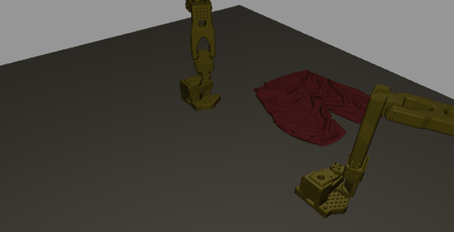
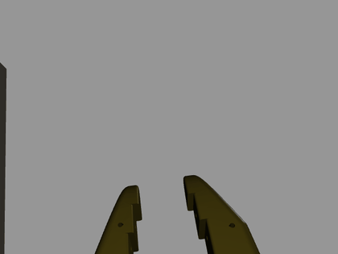
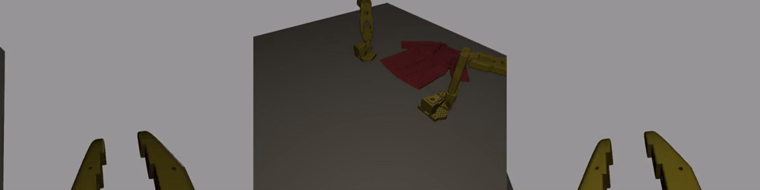

# Bimanual Garment Folding in Isaac Sim

Use camera observations to control two simulated arms folding garments, then check whether the fold remains correct after settling. I built the Isaac Sim integration and paired evaluation workflow around an upstream vision-language-action model.

[](https://jose-sanchez-portfolio-com.vercel.app/projects/isaac-folding/)

*Historical raster-adapted policy on one selected short-pants pose. The challenge checker passed during the episode; this clip does not establish a stable final fold or the latest fine-tune's performance.*

[Case study](https://jose-sanchez-portfolio-com.vercel.app/projects/isaac-folding/) · [Latest completed study](docs/RUNTIME_HORIZON_2026-10-06.md) · [Recorded policy failures](docs/MEDIA_GATE_2026-09-20.md)

## Problem and contribution

A convincing folding clip can hide open-loop replay, a transient checker pass, or a rendering failure. I built the Isaac port, three-camera Storm observation path, policy rollout instrumentation, and source-pinned experiment drivers to distinguish those cases.

The robot, garment assets, challenge checker, and SmolVLA backbone are upstream components. My contribution is their integration, renderer-domain diagnosis, training adaptations, and reproducible evaluation. [Upstream challenge](https://github.com/lehome-official/lehome-challenge) · [Provenance](NOTICE).

## Result: keep the baseline

**The latest runtime screen failed its promotion gate.** On October 6, 2026, the same baseline weights were evaluated at H10 and H50 in **48 matched pairs (96 valid episodes)** on NVIDIA A40 GPUs. H10 replans after ten actions; H50 executes the full predicted 50-action chunk and remains the shipped configuration.

- **Settled folds:** H10 **16/48**; H50 **8/48**, after 600 policy actions plus 60 settling steps.
- **Paired test:** 14 H10-only wins and 6 H50-only wins; one-sided exact p = **0.0577**, above the registered 0.05 threshold.
- **Decision:** retain the baseline. Eight reused development poses and six fresh seeds per pose do not establish held-out generalization.

[Recorded results, protocol, and audit](docs/RUNTIME_HORIZON_2026-10-06.md). This is a runtime comparison with unchanged weights. The separate [September 27 v8 fine-tune](campaigns/20260926-anchor-diagnostic-v8/REPORT.md) scored candidate versus baseline at H10 **9/16 vs 2/16**, but H50 **6/16 vs 8/16** failed non-regression. Neither study justified promotion or spending the final set.

## Visual evidence

### Historical policy camera input



*Policy input during the historical selected rollout. This is not a recording of the October runtime comparison, and a transient checker pass does not establish a settled final fold.*

### Recorded adaptation failure

[](docs/MEDIA_GATE_2026-09-20.md)

*September 20: the adapted seed-0 policy completed 600 actions and 601 validated render calls, but did not fold this development garment. This is a different checkpoint and pose from the hero clip.*

## How it works

1. PhysX particle cloth and bimanual joint state feed three rasterized RGB views: overhead and both wrists.
2. SmolVLA predicts joint-target action chunks; no demonstration actions are injected into policy rollouts.
3. Recovery search branches from baseline states on training garments. Only continuations that finish with a settled fold become supervision.
4. Fine-tuning mixes recovery labels with a behavior-cloning anchor. A held-out demonstration loss guard filters checkpoints.
5. The driver evaluates candidate and baseline together, then checks all four fold conditions after settling. An earlier latched checker pass is reported separately.

[Observer](src/lehome_fold/storm_obs.py) · [Executed rollout](campaigns/20260926-anchor-diagnostic-v8/scripts/render/policy_rollout51.py) · [Trainer](campaigns/20260926-anchor-diagnostic-v8/scripts/rollout_weighted_finetune.py) · [Decision rule](campaigns/20260926-anchor-diagnostic-v8/scripts/driver.py).

## Engineering decisions

- **Storm observations:** bypass the Isaac Sim 5.1 RTX crash on the cluster; diagnose and adapt to the renderer gap instead of attributing it to control.
- **fp32 master weights:** preserve update precision during fine-tuning. A direct stored-weight audit corrects the older 12.9% movement claim to **11.53%** for v3 step 300; weight movement is separate from folding success. [Corrected audit](docs/RUNTIME_HORIZON_2026-10-06.md#corrected-optimizer-measurement).
- **Matched evaluation:** avoid pooling favorable baselines across campaigns. Source hashes, checkpoint hashes, manifests, and a restartable job ledger make each comparison inspectable.
- **Anchor diagnostic:** changing the BC anchor removed a shared early-H50 behavior shift, but also changed capture source and selected training step. Composition alone is not isolated.

The value head, RECAP, and bandit modules are research prototypes; they are not part of the executed v3–v8 recovery-training loop. Detailed experiment history stays in the [campaign reports](campaigns/) and [historical notes](docs/README_long.md).

## Run locally

The CPU modules require Python 3.10+, NumPy, and PyTorch; no simulator is needed. On Linux or macOS:

```bash
git clone https://github.com/joses2017smjh/IsaacSimFolding.git
cd IsaacSimFolding
python3 -m venv .venv
.venv/bin/python -m pip install -r requirements.txt
PYTHONPATH=src .venv/bin/python tests/test_pure.py
```

The test runner covers labels, calibration, weighting, provenance, evaluation parsing, and model heads. It does not validate live cloth physics or the LeRobot interface. [CPU CI](.github/workflows/tests.yml).

GPU rollouts additionally need the challenge assets, pinned Isaac Sim 5.1 / LeRobot environment, Apptainer, and Slurm. Each campaign's driver owns submissions and verifies source hashes; campaign ledgers record outcomes. See [container](container/lehome.def), [campaign setup](campaigns/20260926-anchor-diagnostic-v8/README.md), and [media gate](docs/MEDIA_GATE_2026-09-20.md). No universal GPU quickstart is claimed.

## Project layout and execution

| Path | Purpose |
|---|---|
| [CPU modules](src/lehome_fold/) | Labels, weighting, evaluation parsing, and model heads. |
| [Tests](tests/test_pure.py) | Simulator-free regression checks. |
| [Campaigns](campaigns/) | Pinned training and rollout drivers, manifests, and scored ledgers. |
| [Container](container/lehome.def) | Cluster simulator environment. |
| [Demo evidence](docs/MEDIA_GATE_2026-09-20.md) | Recording provenance and historical success/failure labels. |

This is a simulation research workflow, deployed through campaign drivers on Slurm; it is not a hosted service or a physical folding robot.

## Stack

Python · PyTorch · SmolVLA / flow matching · Isaac Sim 5.1 · PhysX particle cloth · OpenUSD Storm · LeRobot · NumPy · Slurm · Apptainer.

Jose Sanchez · [Portfolio](https://jose-sanchez-portfolio-com.vercel.app/) · [GitHub](https://github.com/joses2017smjh)
